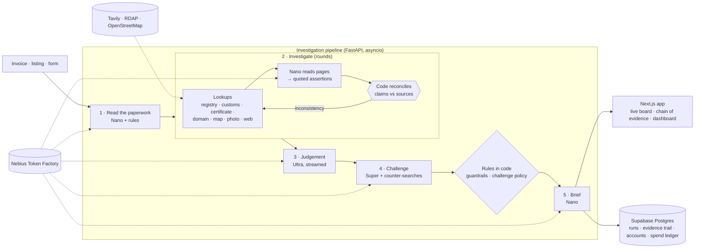

<div align="center">

# ProofBeforePay

**Check the supplier before you pay the deposit.**

Paste a supplier's invoice, listing or chat. An investigation agent resolves who the supplier really is: it checks the company and registration number against corporate registries, looks for customs records, verifies certificates, surveys the address on a map and traces the factory photos. Each inconsistency it finds opens a follow-up lookup on a different source, until there is a chain of evidence. A second model then tries to prove the verdict wrong, and you get one of three answers, **Proceed**, **Verify first** or **Stop**, with every conclusion traceable to its evidence.

[](https://www.nvidia.com/en-us/ai-data-science/foundation-models/nemotron/)
[](https://nebius.com/token-factory)
[](https://tavily.com)
[](apps/api/tests)
[](LICENSE)

Built for the **Nebius × NVIDIA Global AI Hackathon** · Best Apps and Agents

**Live demo:** [proofbeforepay-qaax.onrender.com](https://proofbeforepay-qaax.onrender.com) · **Video:**(https://youtu.be/JhhcloY57W4) · **Docs:** [architecture](docs/architecture.md) · [how it decides](docs/risk-methodology.md) · [threat model](docs/threat-model.md)


</div>

---

## For judges: try it in one click

Open the [live demo](https://proofbeforepay-qaax.onrender.com) (it may take a minute to wake up), then:

- **No account:** pick a sample on the home page and press *Investigate*, or open a recorded example.
- **Signed-in app:** on [Sign in](https://proofbeforepay-qaax.onrender.com/login), press **Demo account** for the dashboard, agent pipeline, history and compare.
- **Admin dashboard:** press **Demo admin** for live system health, budget, users, feedback and messages. Real people's names and emails are masked in this view.

You can also sign in by hand: `demo.judge@example.com` or `demo.admin@example.com`, password `ProofBeforePay-Demo-2026`. Both demo accounts are shared and can't be renamed, deleted or reset.

## Contents

- [The problem](#the-problem)
- [What it does](#what-it-does)
- [Screenshots](#screenshots)
- [How it works](#how-it-works)
- [How we used NVIDIA Nemotron on Nebius Token Factory](#how-we-used-nvidia-nemotron-on-nebius-token-factory)
- [How we used Tavily](#how-we-used-tavily)
- [Honest by design](#honest-by-design)
- [Tech stack](#tech-stack)
- [Run it locally](#run-it-locally)
- [Deploy](#deploy)
- [Configuration](#configuration)
- [API](#api)
- [Project structure](#project-structure)
- [Testing](#testing)
- [Feedback on the tools](#feedback-on-the-tools)
- [License](#license)

## The problem

Small businesses that import from Alibaba, IndiaMART or regional directories lose money to middlemen posing as factories, shell companies, and suppliers using stolen ISO certificates or someone else's factory photos. The checks that would catch them (a registry search, a customs-record lookup, a reverse-image search, a look at the address) each take a while, and the trail only becomes clear when you carry a fact from one source to the next: the registry says the number belongs to a different company, so you search customs data under *that* name, and so on. A single query can't do that, and few buyers have the hours to do it by hand before wiring a 30% deposit.

> *Is this supplier who it says it is, and is it safe to send the deposit?*

ProofBeforePay does the cross-referencing. It's built to say yes to genuine suppliers too, including honest trading companies, because telling a buyer a real supplier is a fraud costs them a good supplier.

## What it does

- **One clear answer.** Proceed, Verify first or Stop, with a confidence score and the main reason in one sentence.
- **Iterative entity resolution.** The agent takes a claim from one source, notices when another source disagrees, and opens a targeted follow-up on a third, up to a fixed budget of rounds, lookups and hops.
- **The chain of evidence.** A tree of every lookup, nested under the finding that made the agent run it. Click any citation in the report to jump to the lookup or source behind it.
- **Seven kinds of lookup.** Corporate registries, customs and trade logs, certificate directories, the supplier's domain record, a map survey of the address (industrial, commercial or residential), reverse-image search of factory photos, and web search for complaints and for who owns a site.
- **Code decides what matches.** Whether two names, registration numbers or addresses agree is decided by deterministic rules, not by a model, and a model's quote is kept only if it appears word for word in the page.
- **We try to prove ourselves wrong.** A second model runs its own searches against every verdict, considers benign explanations (a rename, a group company, a trading arm), audits each finding against its sources, and lists exactly what evidence would change the answer.
- **What to do next.** What not to do yet, questions only a genuine supplier can answer, and a polite message asking them to prove who they are before any deposit.
- **Any input.** Paste text, upload a screenshot or scan of an invoice, give a marketplace listing link, or fill in the company name, registration number, address and certificate number directly.
- **Ask the report.** Follow-up questions are answered from that report's evidence only, with citations you can click.
- **Share, replay, download.** Every check gets a link, replays step by step, and downloads as Markdown or saves as a PDF.
- **Pay-as-you-go credits through PayPal.** A check costs credits, bought in packs with PayPal Checkout (Orders v2, through PayPal's official `paypal-server-sdk`, which APIMatic generates). Runs against the PayPal sandbox by default, so no real money moves. A check that fails is refunded.
- **Accounts, history and compare, and an admin dashboard** for the team running it.

## Screenshots

The screenshots below are from the original job-offer version of the app and will be replaced.

| | |
|---|---|
|  **A genuine case gets a Proceed**, with confidence, signals and the reason. |  **The Proof Trail.** Sources to claims and signals to findings to the verdict. |
|  **The challenge.** Counter-searches, the best case against the verdict, and what would change it. |  **Dashboard.** The agent pipeline with each step's calls, tokens and cost. |

## How it works

Five steps, three Nemotron models, an investigation that follows its own findings, and a verdict that has to survive an argument.



1. **Read the paperwork.** Nemotron Nano extracts the supplier's name, claimed type (factory or trader), address, registration number, certificates, deposit terms and who gets paid. Code turns that into claims and the first lookups, and flags full prepayment, personal-account payment, crypto, off-platform payment and text that tries to instruct AI checkers. If the account holder named on the invoice isn't the supplier, that is already a finding, with no lookup needed.
2. **Investigate.** Each round runs up to six open lookups in parallel. Nano reads the returned pages and reports what they state with a verbatim quote; code compares it with the claims. A registry number that belongs to another company opens a customs lookup under that name, a search for any link between the two names, and a survey of its address. A factory photo found on another site opens a lookup on who owns that site. A certificate held by someone else opens a lookup on the holder. When the rules leave a loose end, Nemotron Super may propose up to two more lookups from the same fixed list. The loop ends when nothing is left to follow or its budget runs out (`MAX_ROUNDS`, `MAX_LEADS`, `MAX_DEPTH`).
3. **Weigh the evidence.** Nemotron Ultra makes one long reasoning pass over every finding, claim and lookup and returns the decision with citations to the chain.
4. **Argue against it.** Super searches for evidence that the verdict is wrong, audits each finding against its sources, and lists what would change the answer. Code decides what a disagreement may change.
5. **Write the brief.** Nano writes a plain-language summary and a safe message to the supplier.

Every step writes to an append-only event log that the browser follows over Server-Sent Events (it reconnects mid-run with `Last-Event-ID`). More in [docs/architecture.md](docs/architecture.md).

## How we used NVIDIA Nemotron on Nebius Token Factory

Each task goes to the smallest Nemotron model that can do it well. Ultra runs once per investigation, where deep reasoning matters, and a *different* model challenges it, so the check isn't one model agreeing with itself.

| Step | Model | Why this tier |
|---|---|---|
| Extract the supplier's profile | **Nemotron 3 Nano** | Structured extraction, latency-sensitive |
| Read each lookup's pages (parallel, one call per lookup) | **Nemotron 3 Nano** | High-frequency calls; output is checked in code, and Super re-reads only if Nano's answer can't be used |
| Propose extra lookups when a finding is left open | **Nemotron 3 Super** | Needs judgement about which source would settle a question; bounded to a fixed tool list |
| Final judgement | **Nemotron 3 Ultra** | One long-context reasoning pass over every finding, claim and lookup, streamed to the UI |
| Challenge: plan counter-searches, argue and audit | **Nemotron 3 Super** | An independent second opinion, cheap enough to run on every verdict |
| Brief and message to the supplier | **Nemotron 3 Nano** | Short-form writing |
| JSON repair (rare) | **Nemotron 3 Nano** | Recovers malformed output instead of failing the run |

Implementation ([`apps/api/app/llm/nebius_client.py`](apps/api/app/llm/nebius_client.py)):

- **Token Factory's OpenAI-compatible API** through the official `openai` SDK, always streaming with `stream_options.include_usage`, so every call reports real prompt and completion tokens.
- **Per-call metering**: tier, model, tokens, latency, time to first token, cost, and what the same tokens would have cost on Ultra. Every report and the dashboard show the real savings from routing.
- **Model catalog resolution**: at startup the server reads `/v1/models` and matches each tier to the closest Nemotron ID if a configured one has moved.
- **Automatic rerouting** to a neighbouring tier if one is unavailable, logged in the run.
- **Thinking control**: fast calls switch reasoning off through `chat_template_kwargs`; Ultra keeps it on, and reasoning (`reasoning_content` or inline `<think>` tags) is split from the answer while streaming.
- **A hard spending ceiling**: `MAX_SPEND_USD` caps total model spend. Each run reserves a worst case before it starts, and the ledger lives in Supabase so restarts don't reset it.

Per-run cost and savings from routing are measured live and shown in each report. The figures published for the earlier job-offer version no longer apply, since an investigation now makes a variable number of lookups; they will be re-measured on the supplier pipeline.

## How we used Tavily and other sources

| Source | Used for |
|---|---|
| Tavily `search` scoped with `include_domains` | Corporate registries, customs and trade-log sites (ImportYeti, Panjiva, Volza…), certification directories |
| Tavily `search` (unscoped, basic) | Complaints, relationships between names, who owns a site, the challenger's counter-searches |
| Tavily `search` with `exact_match` | Exact-phrase lookups |
| Tavily `extract` | The top registry or trade-log hit in full; a pasted marketplace listing (with its image URLs), so this server never opens untrusted links |
| RDAP | How old the supplier's website domain is |
| OpenStreetMap (Nominatim + Overpass) | Geocode the address and count nearby land use and buildings, to tell an industrial zone from an apartment block |
| OpenCorporates API (optional, `OPENCORPORATES_API_KEY`) | Structured registry records |
| Google Cloud Vision Web Detection (optional, `GOOGLE_VISION_API_KEY`) | Reverse-image search of factory photos |

A lookup whose source isn't configured or is down is shown as **not checked**. It creates no finding and never counts for or against the supplier.

## Honest by design

- **Missing evidence is never proof of fraud.** Absence from a registry, a customs log or a certificate directory is marked amber and the claim stays *inconclusive*.
- **No invented quotes or citations.** A model's quote is kept only if it is found word for word in the cited page; references to ids that don't exist are dropped.
- **Code decides what matches.** Names are compared without legal suffixes and city prefixes, registration numbers after normalising, addresses on their numbers and most of their words.
- **Code guardrail.** With a payment red flag, an identity conflict, a supposed factory in a residential area, or text aimed at the checker, the model can't return *Proceed*.
- **A second opinion on every verdict.** When Ultra and Super disagree, the answer becomes *Verify first*, except that a Stop resting on a hard red flag stays a Stop. Findings that claim more than their sources say are kept but marked as disputed.
- **Honest traders aren't accused.** The tool looks for a trader posing as a factory, not for traders.
- **Messages and web pages are data, never instructions** to any agent, including the lead planner, whose output is restricted to a fixed tool list and validated.
- **No accusations.** Reports describe evidence and risk; they never declare a company a fraud, and say a supplier isn't verified as a company whose identity it appears to borrow.

The full rules are in [docs/risk-methodology.md](docs/risk-methodology.md); the security model, including accounts, is in [docs/threat-model.md](docs/threat-model.md).

## Tech stack

| Layer | What we used |
|---|---|
| AI models | NVIDIA Nemotron 3 Nano, Super and Ultra on Nebius Token Factory |
| Web research | Tavily: search (scoped and exact), extract |
| Backend | Python 3.12+, FastAPI, asyncio, Server-Sent Events, the `openai` SDK, RDAP, OpenStreetMap |
| Database | Supabase Postgres over its REST API, with row-level security |
| Email | Resend (one-time codes) |
| Payments | PayPal Orders v2 via `paypal-server-sdk` (APIMatic-generated), sandbox by default |
| Frontend | Next.js 16 (App Router, static export), React 19, TypeScript, Tailwind CSS 4, Zod |
| Motion and 3D | GSAP (ScrollTrigger, SplitText), Lenis, Motion, React Three Fiber |
| Testing | pytest (94 tests, offline), Playwright for browser checks |
| Deploy | One Docker image on Render |

The Next.js site is exported as static files and served by FastAPI, so the app and the API share one origin: login cookies are first-party, live streaming needs no proxy, and there's one container to deploy. Every animation respects the device's reduced-motion setting, and the footer and Settings have a switch to override it for the site.

## Run it locally

**You need:** Python 3.12 or newer, Node.js 20 or newer, a [Nebius Token Factory](https://tokenfactory.nebius.com) API key and a [Tavily](https://app.tavily.com) API key. [Supabase](https://supabase.com) and [Resend](https://resend.com) are optional locally: without them, accounts are kept in memory and sign-up codes are printed in the backend terminal.

### 1. Get the code and your settings

```bash
git clone https://github.com/TheBossMan110/ProofBeforePay.git
cd ProofBeforePay
cp .env.example .env        # Windows: copy .env.example .env
```

Open `.env` and fill in at least `NEBIUS_API_KEY` and `TAVILY_API_KEY`.

### 2. Start the backend (terminal 1)

**Windows (Command Prompt or PowerShell)**

```powershell
cd apps\api
python -m venv .venv
.venv\Scripts\python -m pip install -r requirements-dev.txt
.venv\Scripts\python -m uvicorn app.main:app --reload --port 8000
```

**macOS / Linux**

```bash
cd apps/api
python3 -m venv .venv
.venv/bin/python -m pip install -r requirements-dev.txt
.venv/bin/python -m uvicorn app.main:app --reload --port 8000
```

The API is now on http://127.0.0.1:8000, with interactive docs at http://127.0.0.1:8000/docs.

### 3. Start the frontend (terminal 2)

```bash
cd apps/web
npm install
npm run dev
```

Open **http://localhost:3000**. The dev server forwards `/api` to the backend on port 8000, so sign-in works exactly as in production.

### 4. Optional checks

```bash
# from the repository root: checks your Token Factory, Tavily, Supabase and Resend settings
apps/api/.venv/Scripts/python scripts/check_setup.py     # macOS/Linux: apps/api/.venv/bin/python
# backend tests (offline, no API calls, no cost)
cd apps/api && .venv/Scripts/python -m pytest            # macOS/Linux: .venv/bin/python -m pytest
```

### Production-style, one process

```bash
cd apps/web && npm run build          # exports the site to apps/web/out
cd ../api && .venv/Scripts/python -m uvicorn app.main:app --port 8000
```

Now FastAPI serves the whole app at http://127.0.0.1:8000. Or with Docker: `docker compose up --build`.

### Troubleshooting

| Problem | Fix |
|---|---|
| `uvicorn` or `pytest` "not recognized", or "Fatal error in launcher" | The virtualenv was moved or copied. Delete `apps/api/.venv` and create it again (step 2). Running through `.venv\Scripts\python -m …` avoids activation entirely. |
| PowerShell: "running scripts is disabled on this system" | You don't need to activate: use `.venv\Scripts\python -m uvicorn …` as above. |
| `Another next dev server is already running` | Next allows one dev server per project. Close the other terminal, or stop the process it names. |
| Port 8000 or 3000 already in use | Stop the other server, or use `--port 8001` and set `API_ORIGIN=http://127.0.0.1:8001` before `npm run dev`. |
| Sign-up says "Accounts are unavailable" | Supabase tables are missing: run both files in `apps/api/migrations` in the Supabase SQL Editor. |
| No email arrives | Without `RESEND_API_KEY` the code is printed in the backend terminal. With a key but no verified domain, Resend only delivers to your own account email. |
| No animations | Your device asks for reduced motion (Windows: Settings → Accessibility → Visual effects → Animation effects). Use the **Animations: On** switch in the footer. |
| "Live checks are paused" | The spending ceiling is close. Raise `MAX_SPEND_USD` in `.env` and restart the backend. |

## Deploy

ProofBeforePay deploys as **one Docker service on [Render](https://render.com)**: the image builds the Next.js site and serves it from FastAPI, so there's nothing to host separately (no Vercel needed).

1. Push this repository to GitHub.
2. In Render, choose **New → Blueprint**, pick the repository, and Render reads [`render.yaml`](render.yaml).
3. Fill in the values it asks for: `NEBIUS_API_KEY`, `TAVILY_API_KEY`, `SUPABASE_URL`, `SUPABASE_SECRET_KEY`, `RESEND_API_KEY`, `EMAIL_FROM`, `ADMIN_EMAILS` and `PUBLIC_URL` (your Render URL; you can correct it after the first deploy). `AUTH_SECRET` is generated for you.
4. Deploy. The first build takes a few minutes; then open `https://<your-service>.onrender.com/api/v1/health`.
5. Optional: set `NEXT_PUBLIC_REPO_URL` to your GitHub URL to show the GitHub button in the header, and redeploy.

On Render's free plan the service sleeps after 15 minutes without traffic and takes about a minute to wake, so open the site shortly before a demo.

### Supabase

Create a project, then run [`apps/api/migrations/0001_init.sql`](apps/api/migrations/0001_init.sql) and [`0002_accounts.sql`](apps/api/migrations/0002_accounts.sql) in the **SQL Editor**. `SUPABASE_URL` can be the project URL (`https://<ref>.supabase.co`) or its Postgres connection string; the app talks to Supabase over HTTPS, so it works on hosts without IPv6. Use the **secret** key (called `service_role` on older projects). Row-level security is on with no policies, so only the server can read or write.

### Email

In Resend, create an API key and verify a domain you own, then set `EMAIL_FROM` to an address on it (for example `ProofBeforePay <hello@yourdomain.com>`). Until a domain is verified, Resend only delivers to your own account email. For a demo without a domain, set `EMAIL_TEST_INBOX` to that email: codes Resend won't deliver go there instead, labelled with who they're for, and the verify page tells people to use a demo account.

## Credits and PayPal

Checks cost credits (`CREDITS_PER_CHECK`, default 1). Signed-in users buy packs on the **Credits** page.

1. In the [PayPal developer dashboard](https://developer.paypal.com), open **Apps & Credentials → Sandbox** and create an app. Copy its client ID and secret into `.env` as `PAYPAL_CLIENT_ID` and `PAYPAL_CLIENT_SECRET`. Leave `PAYPAL_ENV=sandbox`.
2. Under **Testing Tools → Sandbox Accounts**, use (or create) a **Personal** (buyer) account. You pay with *that* account's sandbox email and password, never your real PayPal login.
3. Run the third migration (`apps/api/migrations/0003_credits.sql`) if you use Supabase. In-memory mode needs nothing.
4. `apps/api/.venv/Scripts/python scripts/check_setup.py` creates (but never charges) a test order to prove the keys work.
5. Sign in, open **Credits**, buy a pack, and approve it with the sandbox buyer.

How it is built (`app/services/paypal_gateway.py`, `billing_service.py`):

- The browser sends only a pack id. Prices and credit amounts come from `CREDIT_PACKS` on the server.
- The server creates the PayPal order, the buyer approves it on PayPal's page, PayPal returns them to `/billing`, and the **server captures** the payment. Credits are granted only if PayPal reports the capture `COMPLETED` with exactly the amount, currency and our own order reference we asked for.
- The ledger (`credit_ledger`) is append-only with a unique reference per event, so a retried capture, a refresh or a double refund can never grant credits twice. An order can only be captured by the user who created it.
- A failed check is refunded. Administrator and demo accounts don't spend credits.
- With no PayPal keys set, credits are off and checks stay free (useful for local development and the tests).
- To go live later: create a *Live* app, set its keys and `PAYPAL_ENV=live`. Nothing else changes.

## Configuration

All settings are environment variables in `.env` (see [`.env.example`](.env.example) for every option).

| Variable | Required | What it does |
|---|---|---|
| `NEBIUS_API_KEY` | Yes | Nebius Token Factory key for the Nemotron models |
| `TAVILY_API_KEY` | Yes | Tavily key for web research |
| `SUPABASE_URL`, `SUPABASE_SECRET_KEY` | For accounts in production | Postgres for accounts, saved checks, feedback, messages and the spend ledger |
| `RESEND_API_KEY`, `EMAIL_FROM` | For sign-up in production | Sends one-time codes |
| `ADMIN_EMAILS` | For the admin page | Comma-separated emails that can open `/admin` after signing up |
| `EMAIL_TEST_INBOX` | Optional | Without a verified domain, codes go to this inbox instead |
| `DEMO_LOGIN`, `DEMO_JUDGE_EMAIL`, `DEMO_ADMIN_EMAIL` | Optional | The one-click demo accounts (on by default) |
| `PUBLIC_URL` | Recommended | The site's address, used in emails |
| `AUTH_SECRET` | In production | Signs one-time codes; any long random value |
| `APP_ENV` | In production | Set to `production` so codes are never written to the log |
| `MAX_SPEND_USD` | Optional | Hard ceiling on model spend (default $1); live checks pause near it |
| `RUNS_PER_IP_PER_HOUR`, `MAX_RUNS_PER_DAY`, `MAX_CONCURRENT_RUNS` | Optional | Public-demo limits |
| `MODEL_ULTRA`, `MODEL_SUPER`, `MODEL_NANO`, `PRICE_*` | Optional | Model IDs and per-million-token prices for the cost telemetry |
| `MODEL_VISION`, `PRICE_VISION_IN`, `PRICE_VISION_OUT` | Optional | The model that reads screenshots, and its prices |
| `MAX_ROUNDS`, `MAX_LEADS`, `MAX_DEPTH` | Optional | The investigation loop's budget (defaults 4, 16, 3) |
| `GOOGLE_VISION_API_KEY` | Optional | Enables reverse-image search of factory photos |
| `PAYPAL_CLIENT_ID`, `PAYPAL_CLIENT_SECRET`, `PAYPAL_ENV` | Optional | Switches on credits. `PAYPAL_ENV` is `sandbox` (default) or `live` |
| `CREDIT_PACKS`, `CREDITS_PER_CHECK`, `STARTING_CREDITS`, `PAYPAL_CURRENCY` | Optional | What is for sale, what a check costs, free credits for new accounts |
| `OPENCORPORATES_API_KEY` | Optional | Structured company-registry lookups |

To ship a finished run as a replayable example on the home page: `python scripts/seed_demo.py <run_id> <slug>`.

## API

Everything lives under `/api/v1`. The contract is exported to [`packages/shared-types/openapi.json`](packages/shared-types/openapi.json) and browsable at `/docs`.

| Method | Path | Description |
|---|---|---|
| `GET` | `/billing` | Packs for sale, and (signed in) your balance and recent activity |
| `POST` | `/billing/orders` | Start a PayPal checkout: `{ "pack_id" }` → `{ "order_id", "approve_url" }` |
| `POST` | `/billing/orders/{id}/capture` | Finish a purchase after PayPal returns the buyer; the server captures and verifies it |
| `GET` | `/health` | Live-mode status and the resolved model tiers |
| `POST` | `/investigations` | Start an investigation: `{ "message"?, "sender"?, "channel"?, "company"?, "registration_no"?, "address"?, "certificate_no"?, "deposit"?, "listing_url"?, "image_urls"? }` (the paperwork text of at least 40 characters, or a company name, registration number or listing link) → `{ "id" }` |
| `GET` | `/investigations/{id}` | Status and, when finished, the full report |
| `GET` | `/investigations/{id}/events` | Server-Sent Events; `?replay=5` replays at 5× speed, `?replay=0` sends it all at once |
| `GET` | `/investigations/{id}/claims` · `/evidence` · `/report` | The evidence trail and the report as separate resources |
| `GET` | `/examples` | Recorded example investigations |
| `POST` | `/investigations/{id}/ask` | A question about a finished report: `{ "question" }` → `{ "answer" }` with citations |
| `POST` | `/transcribe` | Reads the paperwork out of a screenshot: `{ "image": dataURL }` → `{ "text", "model" }` |
| `GET` | `/stats` | Anonymous totals for the home page: checks run, average time, cost and savings |
| `POST` | `/auth/signup` · `/verify` · `/resend` · `/login` · `/forgot` · `/reset` · `/logout` · `/demo` | Accounts, one-time codes and the demo sign-in |
| `GET` | `/auth/me` | The signed-in user, or `null` |
| `GET` · `PATCH` · `DELETE` | `/me/investigations` · `/me` | Your checks; rename yourself; delete your account and its data |
| `POST` | `/feedback` · `/contact` | A rating on a report; the contact form |
| `GET` | `/admin/overview` · `/users` · `/investigations` · `/feedback` · `/messages` | Admin only |

There's deliberately no public endpoint that lists other people's investigations.

## Project structure

```
apps/
  api/                              FastAPI service
    app/
      main.py                       App, middleware, static site hosting
      core/                         config, logging, security (hashing, codes, sessions, rate limits, spend ceiling)
      api/                          router, deps (current user, admin), v1/ routes
      schemas/  models/             request bodies; the User model
      services/                     investigations, auth, email (Resend), admin; runtime wiring
      agent/                        orchestrator, state, casefile (leads and chains), reconcile (claim vs source rules),
                                    policies (rules over the models), workflow
      intelligence/                 the five steps: claim extractor (intake), investigator (the loop), judge,
                                    challenge pass, report generator
      tools/                        lookup adapters (registry, customs, certificate, domain, map, photo, web), Tavily, RDAP
      risk/                         payment-term patterns, hard-signal board, name/number/address matching
      llm/                          Nebius Token Factory client, prompts, output parser
      repositories/  db/            investigations, users, feedback; Supabase and in-memory tables
    migrations/                     SQL for Supabase
    tests/                          94 tests
    examples/                       recorded investigations shipped with the app
  web/                              Next.js 16 + TypeScript
    src/
      app/(marketing)/              home, how-it-works, about, contact
      app/(auth)/                   login, signup, verify, forgot-password
      app/(app)/                    dashboard, investigate, investigations, history, compare, settings, admin
      components/                   layout, investigation, evidence, claims, risk, reports, ui, marketing, motion
      features/                     auth, dashboard, investigations, admin, settings, contact, decision-brief
      hooks/  lib/  stores/  types/ data hooks, API client, Zod schemas, session store, shared types
packages/shared-types/              OpenAPI contract exported from the API
docs/                               architecture, risk methodology, threat model, demo script, images
scripts/                            check_setup, seed_demo, export_openapi
Dockerfile · docker-compose.yml · render.yaml
```

## Testing

```bash
cd apps/api
.venv/Scripts/python -m pytest        # macOS/Linux: .venv/bin/python -m pytest
```

94 tests cover the full five-step pipeline end to end (a supplier whose registration number, certificate and photos belong to another company, whose address is residential and who asks to be paid personally; a lookup that cannot run; a clean supplier that must be confirmed rather than accused), the loop's round, lead and depth limits, the name, number and address matching rules, the payment-term patterns, the guardrails, the challenge rules, the API, the spending ceiling, and the account flows, and the PayPal credit flow (verified captures, single application, ownership, refunds). They use fake models, fake lookups and an in-memory database, so they run offline in a few seconds and cost nothing.

## Feedback on the tools

- **Nebius Token Factory.** The OpenAI-compatible API meant the official `openai` SDK worked unchanged, including streaming with usage, and every check costs about two cents. Two things slowed us down. The base URL appears in two forms across documentation and integrations (`api.tokenfactory.us-central1.nebius.com/v1/` and `api.tokenfactory.nebius.com/v1`). And exact Nemotron model IDs were hard to find outside the console. They're also case-sensitive and mixed in style: the catalog lists `nvidia/Nemotron-3-Ultra-550b-a55b` next to `nvidia/nemotron-3-super-120b-a12b`, so an all-lowercase Ultra ID that looks right comes back as not found. That's why we added catalog resolution at startup. A copyable model-ID table and documented reasoning toggles for each model would help.
- **NVIDIA Nemotron 3.** Having Nano, Super and Ultra from one family behind one API made tiered routing natural: the same prompt conventions work across tiers, so escalating is a one-line change. Two things we learned in live testing. Ultra sometimes read more into a short search snippet than it said (a vague "corporate-style emails" became a specific claim about a company's own domain); giving it the full official page helped, and having Super audit each finding against its sources catches what's left. And in JSON mode, Super occasionally gave a minimal answer (a bare "holds") unless the prompt said every field had to be filled.
- **Tavily.** `exact_match` and natural-language `crawl` gave us two of our most convincing checks (script fingerprinting and careers-page verification), and `extract` let us inspect suspicious links without our server ever opening them. `include_usage` made honest credit telemetry easy.

## Built during the hackathon

All code in this repository was written during the submission period (October 2026).

## License

[MIT](LICENSE)
