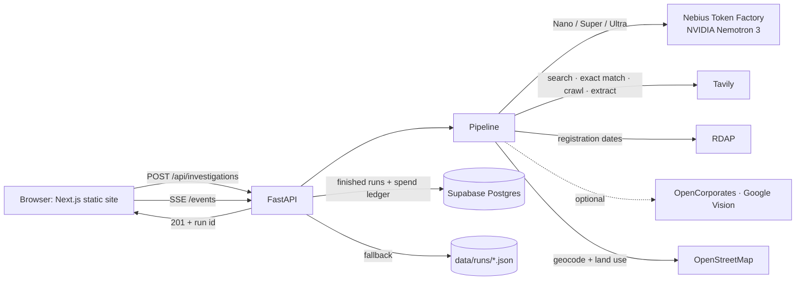
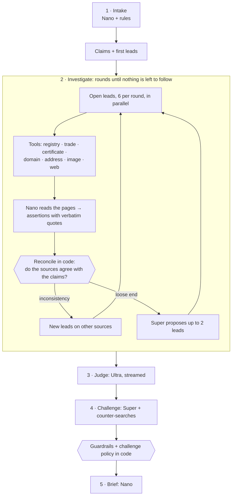

# Architecture

ProofBeforePay is a modular monolith: one FastAPI service runs the investigation and serves the Next.js site as static files. One container, one deploy, nothing to keep in sync. Supabase (Postgres) is optional and holds the investigations and the spending ledger when it's configured.



## One investigation

Each run is an `asyncio` task with an append-only event log. Every step writes events (`stage`, `round`, `lead`, `signal`, `claim`, `source`, `llm_call`, `tavily_call`, `judgement`, `challenge`…) and the browser follows them over Server-Sent Events. A finished run replays from the same log, at its original pace, from a shareable link.



| # | Step | Who does the work | What comes out |
|---|------|-------------------|----------------|
| 1 | Read the paperwork | Nemotron **Nano** + regex rules (and **Tavily Extract** for a listing link) | A supplier profile, claims to check, payment-pattern signals, and the first leads |
| 2 | Investigate | Lookups (`app/tools/adapters.py`), **Nano** to read pages, **code** to reconcile, **Super** for extra leads | Findings, claim statuses, the case file: every lead, why it was opened, what it found |
| 3 | Weigh the evidence | Nemotron **Ultra**, once, reasoning streamed live | Decision, confidence, findings with citations, next steps |
| 4 | Argue against it | **Super** + fresh Tavily searches | Best counter-argument, what would change the verdict, findings that overstate their sources |
| 5 | Write the brief | **Nano** | Plain-language summary and a message asking the supplier to prove who they are |

The loop's budget (`MAX_ROUNDS`, `MAX_LEADS`, `MAX_DEPTH`) bounds cost and guarantees it ends. Leads are deduplicated by tool and normalised target. A lookup that can't run is recorded as *not checked*, never as a finding.

Code, not the models, has the last word on a few things: whether two names, numbers or addresses match, what each claim's status is, which quotes survive (only those found word for word in the page), which citations survive, whether a Proceed is allowed, and what a challenge may change. See [risk-methodology.md](risk-methodology.md).

## Code map

```
apps/api/app/
  agent/          orchestrator (runs the steps), state (run event log, Investigation), casefile (leads, chains, budget),
                  reconcile (claim vs source comparison, follow-up rules), policies (guardrails, challenge rules), workflow
  intelligence/   claim_extractor (intake), investigator (the loop), judge, challenge_pass, report_generator, report_qa
  llm/            nebius_client (tier routing, fallback, streaming, metering), prompts, output_parser
  tools/          adapters (the seven lookups), tavily_search, domain_inspector (RDAP), url_inspector (contacts)
  risk/           rules (payment-term patterns), scoring (SignalBoard), matching (names, numbers, addresses, quotes)
  services/       investigation_service, auth_service, email_service (Resend), admin_service, runtime (wiring)
  repositories/   investigation_repo, user_repo, feedback_repo, run_store (memory + JSON + examples)
  db/             a small table interface with Supabase (REST) and in-memory implementations
  api/v1/         health, investigations, evidence, reports, auth, me, billing, deposits (+ PayPal webhook), feedback, contact, admin
  core/           config, logging, security (scrypt, code and session digests, rate limits, spend ceiling)
apps/api/tests/   fake models, fake lookups, in-memory database
apps/web/src/     Next.js App Router: (marketing), (auth) and (app) route groups
```

## Storage

A finished run is written to `apps/api/data/runs/<id>.json` and, when Supabase is configured, to Postgres: one `investigations` row with the report (including the case file) and event log (used for report links and replays), plus the evidence trail as rows in `claims`, `sources`, `evidence`, `signals` and `findings`. Every run's model cost goes into `spend_ledger`, so the spending ceiling survives restarts on hosts with throwaway disks. Accounts (`users`, `email_codes`, `sessions`), `feedback` and `contact_messages` live alongside them. Row-level security is on with no policies; only the server's secret key can read or write.

## Payments (PayPal)

`services/paypal_gateway.py` is the only module that talks to PayPal, through the official `paypal-server-sdk`
(APIMatic-generated): Orders v2 (create with `CAPTURE` or `AUTHORIZE`, authorize, capture, get, tracking), Payments v2
(capture an authorization, void it) and webhook signature verification.

`services/deposit_service.py` gates every deposit on the stored report's verdict: PROCEED creates a `CAPTURE` order paid to
the supplier's PayPal (`payee.email_address`), VERIFY_FIRST creates an `AUTHORIZE` order (a hold), STOP is refused. A hold
is released (captured) only after Nemotron Super reviews the supplier's proof against the report's verification questions;
the model reports facts per question and code derives RELEASE / KEEP_HOLDING / VOID, with the pattern rules in
`risk/rules.py` overruling it. Deposits and their review/timeline live in the `deposits` table
(`migrations/0004_deposits.sql`); handled webhook ids in `paypal_events`. Credit packs for checks use the same gateway
(`services/billing_service.py`).

## Deployment

The Dockerfile builds the Next.js static export in one stage and copies it into the Python image. `render.yaml` describes a single free web service. The site, the API and the docs (`/docs`) all come from the same origin.
